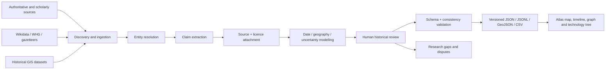
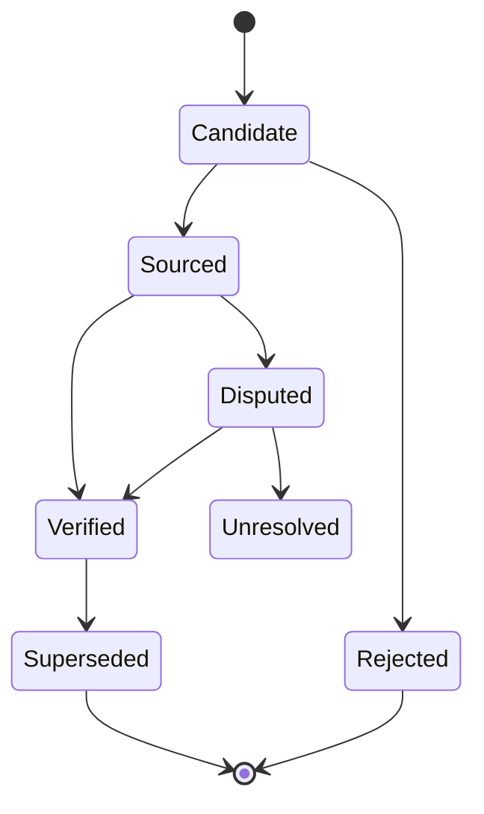

# World History Atlas: Provenance-First Research and Data Architecture for Global History, 1500–2026

## Executive summary

The request does not state a single research question, but the uploaded brief provides a strong substantive direction: build **World History Atlas**, a globally comprehensive, source-traceable historical knowledge base spanning 1500 CE to 2026 CE, with civilisations, events, technologies, historical geography, relationships, people, everyday life and civilisation-specific geographical knowledge as interoperable datasets. fileciteturn0file0

Several deep-research topics are therefore plausible: a substantive world-history survey of 1500–2026; reconstruction of historical political geography; a comparative history-of-technology database; a civilisation-interaction network; or the research/data methodology needed to build all of those reliably.

**Chosen topic: a provenance-first research and data architecture for World History Atlas, covering 1500–2026.**

This is the highest-leverage choice. Attempting the requested “comprehensive” historical collection immediately would create a large amount of expensive-to-rework material unless entity identity, dates, geographical uncertainty, claim-level sourcing, licensing and dispute handling are settled first. Existing resources are useful but incompatible in important ways. Wikidata is broad and CC0 but should function mainly as an entity-resolution and discovery layer; World Historical Gazetteer is strong for historical places and reconciliation but preserves source-dataset licensing; Cliopatria provides unusually broad global polity polygons but its authors explicitly warn that historical boundaries are uncertain and that its polygons represent only one interpretation; CShapes gives much higher-resolution political boundaries from 1886 but deliberately omits some smaller territorial changes; and Australian Indigenous resources explicitly caution that mapped locations and boundaries may be approximate, contested or inappropriate for authoritative territorial use. citeturn0search0turn1search0turn13search0turn2search0turn3search1turn3search2

The principal conclusion is that **the Atlas should store sourced historical assertions rather than pretending to store a single set of immutable historical “facts”**. A polity, person, technology or place should have a stable identity, while dates, names, capitals, territory, relationships, technological capabilities and population estimates should be time-dependent claims backed by one or more sources. This follows established provenance principles: W3C PROV explicitly models entities, activities, derivations and responsible agents, while the Pelagios PLATO model similarly asks what a source says about a place, which source says it and when the assertion applies. citeturn7search3turn1search11

A second major conclusion concerns the requested 500-year intervals. **“1500–2000” cannot be treated as an inclusive 500-year interval: it contains 501 numbered CE years.** The clean convention is half-open machine intervals:

| Research batch | Machine interval | Human-readable coverage |
|---|---:|---|
| Complete 500-year batch | `[1500, 2000)` | 1500–1999 CE |
| Final partial batch | `[2000, 2027)` | 2000–2026 CE |

This avoids overlaps and omissions and is compatible with precise event dates within each batch. Approximate and uncertain historical dates should additionally use EDTF-style representation or equivalent structured bounds; the Library of Congress EDTF standard specifically supports approximate, uncertain, unspecified and interval dates. citeturn6search0turn6search1

The recommended implementation is a **hybrid pipeline**, not a giant manual encyclopaedia and not an automated scrape:



A realistic first target is **not** “finish 1500–1999”. It is to validate the methodology on a deliberately heterogeneous global pilot, for example 1500–1599 across every major world region, before scaling the same schema across the rest of the 500-year interval. The existing brief correctly prioritises reusable structured records over a long narrative. fileciteturn0file0

## Candidate topics, assumptions and selection

The unspecified query permits several defensible research directions. The following ordering prioritises what would most reduce project risk.

| Priority | Plausible research topic | Value | Main weakness if done first |
|---|---|---|---|
| **Highest — chosen** | Provenance-first research and data architecture for World History Atlas | Establishes identifiers, evidence rules, schemas, licences and uncertainty handling for every later dataset | Produces infrastructure and methodology before maximum visible historical content |
| High | Global historical survey, 1500–2026 | Directly populates civilisations, events and biographies | High risk of inconsistent sourcing, duplicated entities and false precision without a settled model |
| High | Global historical geography and political-boundary reconstruction | Powers the Atlas's defining map interface | Boundary uncertainty and incompatible licences make naïve polygon aggregation dangerous |
| Medium-high | Comparative technology diffusion, 1500–2026 | Distinctive interactive feature with strong educational value | “Invention”, “first evidence”, “adoption” and “widespread use” are often conflated |
| Medium | Civilisation relationship graph | Enables trade, war, diplomacy, migration and cultural-network exploration | Direct, indirect and hypothetical contact are easy to confuse |
| Medium | “See the world through their eyes” historical geographical knowledge | Highly differentiated product feature | Requires intensive source-by-source analysis of maps, texts, travel accounts and inferred awareness |

The chosen topic follows directly from the uploaded specification, which requests stable identifiers, claim-level source traceability, uncertain dates, time-dependent observations, sourced geography, technology diffusion, source licences and machine-readable validation. fileciteturn0file0

**Explicit assumptions.** The Atlas remains a personal educational project rather than an enterprise platform; English is the primary interface language, while historically attested names should be retained in original scripts where practical; open or reusable data are preferable, but copyrighted scholarship may still be cited as evidence without copying protected content; and the database should preserve enough rights metadata that future public or commercial distribution remains possible. No application repository or current schema was supplied here, so this report cannot perform the brief's requested repository/schema inspection and does not assume a particular database, framework or hosting provider. fileciteturn0file0

**Unspecified constraints that materially affect implementation** are the desired record volume, acceptable manual-review workload, whether the final dataset itself must be redistributable, the application's current database technology, spatial-resolution requirements, storage limits, whether paid academic sources are acceptable for verification, and whether Indigenous or culturally sensitive knowledge requires additional community-governance mechanisms beyond conventional copyright licensing.

One assumption deserves particular challenge: “comprehensive” cannot sensibly mean “every historically identifiable community, event, person and technological development worldwide from 1500 to 2026”. No finite personal project will exhaust that domain. The operational definition should instead be **systematically extensible, geographically balanced, source-traceable coverage with explicit gaps**. That interpretation is consistent with the uploaded requirement that a smaller verified dataset is preferable to fabricated breadth. fileciteturn0file0

## Background, key questions and hypotheses

World History Atlas is not fundamentally an encyclopaedia-writing problem. It is a **temporal knowledge-graph and historical-GIS problem whose records happen to support narrative presentation**. Historical entities remain conceptually stable while their attributes change: a polity may change name, capital, government, religion, borders and international relationships without necessarily becoming a wholly new civilisation. The uploaded brief already recognises this by calling for stable historical entities separated from time-dependent observations. fileciteturn0file0

That distinction matters because existing historical datasets embody different ontologies. Wikidata represents knowledge as statements with properties, values, qualifiers, references and ranks, which is useful for time-dependent assertions. It also distinguishes an unknown value from an assertion that no value exists—exactly the distinction the Atlas needs to avoid turning missing historical evidence into a negative historical claim. citeturn9search0turn9search9

Historical geography creates an even harder modelling problem. The 2025 Cliopatria paper provides a useful empirical demonstration: its creators compiled more than 1,600 political entities using source maps and specialist literature, but found substantial disagreement between different databases over some polity extents. The authors explicitly note that digital polygons by themselves cannot represent the uncertainty conveyed by blurred, stippled or ambiguous boundaries on historical maps. The current Seshat implementation reports more than 1,800 entities and retains the warning that past borders have differing interpretations. citeturn13search0turn13search13

The corresponding questions for World History Atlas are therefore:

**What is the atomic unit of truth?**  
Hypothesis: not an entity row, but a **claim**: subject + predicate + value + valid time + evidence + confidence + provenance.

**Can one global historical-boundary source provide authoritative polygons?**  
Hypothesis: no. Cliopatria supplies an excellent baseline through 2024, CShapes adds particularly useful resolution from 1886, OpenHistoricalMap contributes reusable community data, and source maps can refine individual cases; conflicts among them must remain representable rather than silently overwritten. Cliopatria itself identifies disagreements among historical GIS resources, while CShapes documents its own inclusion rules and omissions. citeturn13search0turn2search0

**Can Wikidata serve as the Atlas database?**  
Hypothesis: it should serve as a **cross-reference and discovery backbone, not the final historical authority**. Its structured data are CC0 and it supports qualifiers and references, but Wikidata's own guidance says most statements should be supported by sources; the Atlas should therefore resolve through Wikidata identifiers where useful while retaining and evaluating the underlying scholarly sources. citeturn0search0turn9search5turn9search8

**Should uncertainty be encoded only through HIGH/MEDIUM/LOW labels?**  
Hypothesis: no. Editorial confidence is useful but insufficient. Date precision, spatial uncertainty, source type, scholarly disagreement and inference level are different dimensions. EDTF can encode uncertain or approximate chronology, while geographical claims need separate geometry confidence and geometry type. citeturn6search0turn13search0

**Can technology history be represented as a simple invention date?**  
Hypothesis: usually not. The uploaded specification's distinction between precursor, earliest attested evidence, independent invention, diffusion, adoption, widespread use and improvement is the correct model. fileciteturn0file0

**Can “world knowledge” be inferred from trade connections?**  
Hypothesis: no. The uploaded three-layer scheme—attested knowledge, historically inferred awareness, and unknown/unsupported—is necessary precisely because exchange networks do not prove that participants possessed modern-style geographical understanding of every node in those networks. fileciteturn0file0

The result is a broader principle: **the Atlas should be able to contain contradictory scholarly interpretations without corrupting its data model**. “Disputed” should mean multiple attributable claims coexist; it should not mean the software has failed to decide.

## Methodology and source strategy

The proposed research method separates **discovery**, **evidence**, **normalisation** and **editorial judgement**.

The first pass builds a coverage matrix by time, region and record type. For each geographic macro-region, the matrix should track societies/polities, settlements, events, technologies, relationships, figures, cultural records, historical maps and geographical-awareness records. This operationalises the uploaded requirement to detect regional gaps instead of accidentally reproducing the visibility biases of European-language historiography. fileciteturn0file0

Sources should then be classified by function rather than treated as interchangeable.

| Source | Recommended Atlas role | Current access/licence position | Critical limitation |
|---|---|---|---|
| **Wikidata** | IDs, aliases, cross-links, initial dates/relationships and candidate entities | Structured data are CC0; dumps and multiple access methods are available. citeturn0search0turn0search12 | Secondary aggregation; individual claims still require verification |
| **World Historical Gazetteer** | Historical place reconciliation, names, geometries and linked gazetteers | Entity and reconciliation APIs exist; WHG curation moved to CC BY 4.0 from 30 September 2026, while underlying datasets retain their own licences. citeturn1search0turn1search2turn1search7 | Licence must be evaluated dataset-by-dataset |
| **Cliopatria / Seshat** | Seed polity extents and polity chronology | Worldwide polity data to 2024; dataset licence is CC BY 4.0. citeturn10view0turn11view0 | Boundaries encode one reconstruction and have unquantified uncertainty |
| **CShapes 2.0** | High-resolution state/dependency polygons for the modern period | Global states and dependencies from 1886–2019; free for academic and other non-commercial use. citeturn2search0turn2search9 | Excludes some smaller territorial transfers and wartime changes; not suitable as the sole current boundary layer |
| **OpenHistoricalMap** | Supplementary historical features, candidate geometries and comparison | Most OHM data are CC0; bulk/Overpass options are available. citeturn0search9turn0search19 | Collaborative data quality and source depth vary by feature |
| **Pleiades** | Stable IDs for older places that persist into the early-modern world; scholarly place cross-linking | Open under CC BY 3.0; bulk JSON, CSV, KML and RDF exports available. citeturn0search3turn0search13 | Primarily an ancient-world gazetteer, therefore supplementary for 1500+ |
| **PeriodO** | Normalising scholarly historical-period definitions | Public-domain gazetteer of scholarly period definitions. citeturn1search6 | Period labels are historiographical classifications, not events |
| **AIATSIS AustLang** | Australian Indigenous language identifiers, names, references and approximate locations | Stable AustLang codes and documented reference records. citeturn3search1 | Locations are approximate; AIATSIS explicitly warns against authoritative territorial interpretation |
| **AIATSIS Map of Indigenous Australia** | Discovery/context only unless reproduction permission is obtained | Map locations and boundaries are deliberately general/blurred; reproduction requires permission. citeturn3search2 | Not a cadastral or native-title map; some representations are contested |
| **TLCMap** | Australian historical-place discovery and researcher-contributed spatial layers | Supports map layers, downloads and GeoJSON/CSV; individual layers carry their own licence terms. citeturn3search13turn3search14 | User-contributed layers vary substantially in completeness and rights |
| **National Library of Australia / Trove** | Maps, primary printed sources, archival discovery and digitised historical material | NLA exposes extensive digitised historical holdings; rights are item-specific. citeturn5search4turn4search1 | Bulk-content reuse requires caution; API-content access has been the subject of tightened enforcement reports since 2025. citeturn5search1turn5search5turn5search11 |

The source hierarchy should be:

**Primary evidence:** contemporary maps, treaties, archival documents, inscriptions, official records, artefacts and historically produced texts.

**Scholarly interpretation:** peer-reviewed papers, archaeological reports, specialist monographs, university databases and professionally curated museum/heritage records.

**Structured scholarly aggregators:** WHG, Pleiades, PeriodO, Cliopatria, CShapes and specialised institutional datasets.

**Discovery sources:** Wikidata, Wikipedia and broad reference works. These accelerate entity discovery but should not decide disputed claims by themselves.

The Atlas's own source registry should record at minimum `source_id`, full citation, creator/institution, publication date, persistent identifier, URL, source type, licence, access date, language, archival snapshot where permitted, and notes about applicable rights. WHG's current model illustrates why the licence must travel with source data: WHG's own aggregation carries its licence, but it does not erase the terms attached to contributing datasets. citeturn1search0turn1search5

Chronological normalisation should combine the project's astronomical year numbering with explicit human labels. The machine representation should never infer false precision. For example, “c. 1570” requires approximate metadata; “late sixteenth century” requires bounded uncertainty; “before 1600” is not equivalent to `1599`; and competing chronologies should coexist. EDTF already provides standard expressions for approximate (`~`), uncertain (`?`), uncertain-and-approximate (`%`), unspecified digits and open or bounded intervals. citeturn6search0turn6search7

Geographical research should likewise distinguish at least `exact_or_attested`, `reconstructed`, `approximate_core`, `sphere_of_influence`, `disputed`, and `unknown`. This is not academic pedantry. AIATSIS explicitly says its language map points are approximate and its national Indigenous map intentionally uses blurred rather than fixed borders, while Cliopatria's authors state that ordinary polygons cannot by themselves encode the uncertainty visible in source cartography. citeturn3search1turn3search2turn13search0

Finally, provenance should be claim-level. W3C PROV's underlying idea—that provenance records the entities, activities and agents involved in producing information—is directly applicable, although the Atlas need not implement every part of PROV-O internally. citeturn7search3turn7search7

## Evidence-based analysis and proposed architecture

The strongest available evidence points towards a **layered rather than monolithic architecture**.

A central `entity` table should answer only “what thing are we talking about?” It should not contain the supposedly timeless capital, borders, population or political system. Those belong in temporal observations. Wikidata's statement model and the historical-place approaches of WHG/Pelagios both support the broader principle that assertions need context rather than being flattened into one value. citeturn9search0turn1search4turn1search11

A minimal relational/logical model would be:

| Dataset | Purpose | Essential fields |
|---|---|---|
| `entities` | Stable identity for societies, places, people, technologies, religions, languages, events | ID, type, preferred label, external IDs |
| `entity_names` | Time/language-dependent names | entity, name, language/script, start/end, source |
| `claims` | Atomic historical assertions | subject, predicate, object/value, valid time, confidence |
| `sources` | Bibliographic and rights registry | citation, DOI/URI, licence, access date |
| `source_claims` | Evidence linking | claim, source, page/section, evidence type |
| `geometries` | Time-dependent spatial representation | entity, geometry, start/end, geometry type, uncertainty, source |
| `relationships` | Trade, war, alliance, influence, migration etc. | A, B, relationship type, direction, dates, sources |
| `technology_developments` | Earliest evidence, adoption, diffusion, improvement | technology, society, development type, dates, location, evidence |
| `historical_maps` | Original historical maps and scholarly reconstructions | creator, date, institution, rights, coverage, map type |
| `geographical_awareness` | What a society knew or plausibly knew | society, place/region, A/B/C evidence layer, date, source |
| `research_gaps` | Explicit missing or disputed information | target, gap type, priority, status |

The key architectural change from many conventional historical databases is the separation of `claims` from `entities`. Consider a capital: instead of `civilisation.capital = X`, the record becomes “source S supports the assertion that polity P used place X as a capital during interval T”, potentially alongside a competing claim. That structure naturally supports moving capitals, co-capitals and disputed chronologies.

An abbreviated production record could look like this:

```json
{
  "claim_id": "claim_example_001",
  "subject_id": "polity_example",
  "predicate": "capital",
  "object_id": "place_example",
  "valid_time": {
    "start_year_min": 1580,
    "start_year_max": 1585,
    "end_year_min": 1600,
    "end_year_max": 1605,
    "start_label": "c. 1580–1585",
    "end_label": "c. 1600–1605"
  },
  "confidence": "MEDIUM",
  "evidence_status": "modern_scholarly_interpretation",
  "source_ids": ["source_example_01"],
  "review_status": "human_verified"
}
```

The date bounds and confidence are intentionally separate. An exact date supported by one contentious account can be chronologically precise but historiographically disputed; an approximate date supported by overwhelming evidence can be chronologically imprecise but historically high-confidence.

**Historical geography needs multiple concurrent representations.** Cliopatria is particularly instructive here. Its 2025 paper describes redrawing source-map boundaries onto common digital maps, validation against other historical data, and substantial disagreement for some regions such as steppe polities. Its authors explicitly caution that apparent long-term border stability may sometimes reflect gaps in historical records rather than actual stability. citeturn13search0

The Atlas should therefore never reduce a polity to a single canonical polygon without context. At minimum:

```text
geometry
  entity_id
  valid_from / valid_to
  geometry
  geometry_role = core | control | claimed | influence | disputed | reconstruction
  method = source_map | scholarly_dataset | georeferenced_reconstruction | inferred
  source_id
  positional_uncertainty
  confidence
  alternative_group_id
```

From 1886 onward, CShapes 2.0 is especially useful for state and dependent-territory baselines because its changes can be coded at very high temporal resolution. But the paper states that its coding excludes territorial transfers below a specified size threshold and generally excludes wartime territorial changes unless subsequently formalised, so its apparent precision must not be mistaken for exhaustive completeness. citeturn2search0turn2search3

For earlier periods, Cliopatria is the strongest readily reusable global starting layer identified in this research, but it must be labelled as a reconstruction. It covers worldwide polities from 3400 BCE through 2024 CE and publishes its data openly; its own methodological paper is unusually candid about gaps, varying sampling intervals and uncertain boundary locations. citeturn13search0turn11view0

**Place identity should be reconciled, not reinvented.** WHG's current Entity API can expose names, types, geometries, temporal bounds, authority information and linked resources, and its reconciliation service is intended to match historical place records. Pleiades uses stable place URIs and provides bulk exports, though its centre of gravity is antiquity. citeturn1search7turn0search22turn0search13

The ideal Atlas place identity is therefore its **own stable ID plus external crosswalks**, for example:

```text
place_wha_00001234
  wikidata: Q...
  whg: ...
  pleiades: ...
  geonames: ...
  austlang: ...
```

External IDs should never themselves become the Atlas primary key; third-party datasets can merge, split or change their modelling choices.

**Technological history requires event-like developments rather than one date per technology.** The uploaded design is strong here and should be preserved. fileciteturn0file0 A technology such as a navigation instrument or manufacturing process should have separate records for precursor, earliest attested evidence, likely independent development, adoption by a society, widespread use, improvement and transmission. The result supports a meaningful technology graph without asserting that the oldest surviving artefact identifies an inventor.

A useful internal distinction would be:

| Development type | Meaning |
|---|---|
| `precursor` | Earlier capability required for later development |
| `earliest_attested_evidence` | Oldest evidence currently identified |
| `possible_independent_development` | Evidence supports local development but origin is unresolved |
| `documented_transmission` | A route or contact mechanism is evidenced |
| `adoption` | Technology appears in a society |
| `widespread_use` | Evidence indicates substantial rather than exceptional use |
| `improvement` | Technically distinguishable modification |
| `obsolete_or_replaced` | Use declines or another system supersedes it |

The database should prohibit transforming `earliest_attested_evidence` into an automatically generated UI claim saying “invented by”. That would directly violate the historical caution built into the project brief. fileciteturn0file0

**Civilisation relationships should also be claims, not edges without evidence.** Direct trade, indirect exchange, conquest, migration, religious influence and hypothetical cultural transmission are fundamentally different assertions. A graph UI may display all of them, but the underlying edge needs evidence, time and directionality. The uploaded specification already demands this distinction. fileciteturn0file0

**Geographical awareness is the least automatable feature.** It is tempting to infer that because goods travelled from A to C through B, A “knew about” C. That inference is too strong. The proposed Layer A/B/C distinction from the brief is methodologically sound and should become a first-class schema field rather than prose. fileciteturn0file0 Surviving historical maps and texts can support Layer A; documented diplomatic or repeated direct commercial contact may support carefully explained Layer B; everything else should remain Layer C rather than being filled through speculation.

For Australia, an additional governance rule is justified. AIATSIS states that AustLang's mapped locations are approximate and that its broader Indigenous Australia map contains contested information, deliberately non-exact boundaries and reproduction restrictions. Those warnings are exactly the sort of source-level constraints the Atlas must preserve. citeturn3search1turn3search2 The system should therefore support `cultural_sensitivity`, `community_authority`, `reuse_restriction` and `display_warning` metadata rather than treating all historical GIS data as ordinary polygons.

**Automation should be used for throughput, not epistemic authority.** Bulk imports from Wikidata can discover entities and cross-identifiers efficiently because its structured data are CC0 and available through dumps and linked-data access. Wikidata statements can carry qualifiers and references, but its own sourcing guidance still expects verifiability. citeturn0search5turn9search4turn9search5 Automated imports should therefore enter a `candidate` or `unverified` state until the Atlas has attached appropriate evidence.

A sensible record state machine is:



This makes correction normal rather than exceptional and allows source updates to propagate without deleting the scholarly history of a claim.

## Implications, risks and actionable recommendations

The largest project risk is **false completeness**. A visually rich Atlas can appear authoritative even when its data are uneven. Polygons are especially dangerous because a crisp line on a screen gives an impression of precision that the historical evidence may not support. Cliopatria's technical discussion and AIATSIS's deliberately approximate mapping demonstrate that this is a real methodological problem, not merely a theoretical concern. citeturn13search0turn3search2

The interface should therefore communicate evidence. A user selecting a boundary should be able to see whether it is attested, reconstructed, disputed or approximate; selecting a technology milestone should expose whether it represents earliest evidence or widespread adoption; selecting a relationship should indicate direct versus inferred contact. Hiding those distinctions would undermine one of the Atlas's strongest potential educational contributions.

A second major risk is **licence contamination**. Wikidata's CC0 data, Cliopatria's CC BY 4.0 data, Pleiades's CC BY 3.0 material, WHG's mixed underlying datasets, CShapes's non-commercial terms, TLCMap's per-layer rights and item-specific archival rights cannot simply be merged into one downloadable dataset and labelled “open”. citeturn0search0turn11view0turn0search3turn1search0turn2search0turn3search14

The solution is to maintain **two different concepts**:

`historical_claim_licence` — normally the Atlas's own original structured assertion or sufficiently factual data; and  
`source_asset_licence` — the rights governing an imported geometry, image, map, text or dataset.

For maximum future flexibility, direct data ingestion should preferentially use CC0, public-domain or attribution-only material. Non-commercial datasets such as CShapes can remain a research/verification source or an optional non-commercial layer rather than silently entering a generally redistributable core.

A third risk is **coverage bias disguised as neutrality**. The record-production rate will naturally be higher for literate states, European colonial archives and modern nation-states than for societies whose evidence is archaeological, oral or held in culturally restricted knowledge systems. The correct response is not to manufacture equal quantities of data. It is to record the imbalance and actively commission targeted research in underrepresented regions, exactly as the uploaded brief requires. fileciteturn0file0

A fourth risk is **over-engineering**. CIDOC CRM is powerful and has formal extensions for geospatial integration, while Linked Art offers a modern cultural-heritage sharing model, but a personal educational project does not need to implement either ontology internally in full. CIDOC CRM's current official release remains 7.1.3, and CRMgeo explicitly exists to connect cultural-heritage concepts with geospatial semantics; these standards are useful interoperability references rather than reasons to make the operational database excessively abstract. citeturn6search10turn6search13turn6search6

The recommended architecture is therefore **simple internally, interoperable externally**: ordinary relational or document records, JSON/JSONL exports, GeoJSON geometry, stable Atlas IDs, external crosswalks, EDTF-compatible uncertainty and provenance fields that can later be mapped to W3C PROV/CIDOC-style representations.

The implementation sequence should be:

| Phase | Deliverable | Estimated effort* | Exit criterion |
|---|---|---:|---|
| Schema and policy | Entity/claim/source/date/geometry models; interval convention; licence policy | 15–25 person-days | Representative sample validates without special-case fields |
| Source adapters | Wikidata, WHG, Cliopatria, selected Australian/institutional sources | 20–35 person-days | Repeatable imports with provenance and licences |
| Global pilot | 1500–1599, all major regions, limited representative records | 35–60 person-days | Regional coverage report and <5% structural validation failures |
| Thematic pilot | Technology, relationships, maps and worldview records | 25–45 person-days | Distinction between evidence, diffusion and inference works in UI |
| Scale-out | 1600–1999 in batches; then 2000–2026 | Hundreds of person-days | Incremental verified releases rather than one “big bang” completion |

\*These are planning estimates for this project design, not measured industry benchmarks or quotations.

At an illustrative internal opportunity cost of **A$800 per person-day**, the first four phases imply roughly **A$76,000–A$132,000** of labour equivalent. For a self-built personal project, actual cash expenditure can be far lower because many identified datasets and software components are open, but the research time does not disappear. The dominant cost is human verification, not storage or APIs. This A$800/day figure is an explicit modelling assumption, not a claim about prevailing Australian rates.

A sensible pilot target is deliberately modest:

| Record type | Pilot target for 1500–1599 |
|---|---:|
| Societies/polities/cultures | 100–150 |
| Events | 300–500 |
| Historical figures | 150–250 |
| Settlements/places | 500–1,000 |
| Technology developments | 150–250 |
| Relationships | 150–300 |
| Historical maps/map records | 25–50 |
| Geographical-awareness claims | 50–100 |
| Distinct scholarly/primary sources | 100–200 |

These are **coverage targets, not claims about how many historically significant entities actually existed**. Their purpose is to make the first validation corpus large enough to expose schema failures while remaining reviewable.

Five actions should be treated as immediate requirements.

**First, lock the interval convention:** `[1500,2000)` followed by `[2000,2027)`. Do not create an inclusive “1500–2000” 500-year batch.

**Second, build `sources` and `source_claims` before bulk historical records.** A historical datum that cannot identify its evidence should fail validation rather than become production data.

**Third, implement separate date precision, historical confidence and dispute status.** Do not compress those into one score.

**Fourth, make geometries versioned historical claims.** Never overwrite competing reconstructions; group alternatives and state their evidence.

**Fifth, run a geographically diverse 1500–1599 pilot before bulk-producing the 1500–1999 interval.** It should contain the Ottoman, Safavid and Mughal spheres; Ming China and East Asia; states and networks of West, Central, East and Southern Africa; Europe; Central Asia; Southeast Asia; Indigenous societies of Australia and Oceania; Mesoamerica and the Andes; North American societies; Atlantic and Indian Ocean networks; and non-state or confederated societies where the evidence permits. The purpose is schema stress-testing, not an early-modern “great empires” list.

The next historical research interval after that pilot should be **1600–1699**, not because the product's formal batch is only a century, but because century-sized research waves make verification, rollback and gap analysis manageable while all exported records still belong to the formal `[1500,2000)` batch.

## Prioritised sources and appendices

The following sources deserve highest priority in the actual Atlas research programme.

| Priority | Source | Primary use |
|---|---|---|
| **Essential** | World Historical Gazetteer | Historical place reconciliation and linked geography; current API and licensing framework. citeturn1search0turn1search7 |
| **Essential** | Wikidata | Entity discovery, aliases, external identifiers and preliminary structured relationships; CC0. citeturn0search0turn9search0 |
| **Essential** | Bennett et al., *Cliopatria* (Scientific Data, 2025) plus dataset | Global historical-polity baseline and, equally importantly, documented methodological limitations. citeturn13search0turn11view0 |
| **High** | CShapes 2.0 | Political boundaries and capitals from 1886–2019 with documented coding rules. citeturn2search0 |
| **High** | OpenHistoricalMap | Open historical geospatial leads and reusable map features. citeturn0search9 |
| **High** | Library of Congress EDTF | Canonical representation strategy for uncertain and approximate chronology. citeturn6search0turn6search1 |
| **High** | W3C PROV | Provenance reference model for claim derivation and responsibility. citeturn7search3 |
| **High** | Pelagios/PLATO | Evidence-centred historical-place modelling and linked-data interoperability. citeturn1search11turn1search4 |
| **Regional essential** | AIATSIS AustLang and AIATSIS Indigenous Australia guidance | Australian Indigenous names, languages, mapping cautions and culturally appropriate uncertainty. citeturn3search1turn3search2 |
| **Regional high** | TLCMap | Australian historical-cultural geography and researcher-contributed layers. citeturn3search13turn1search16 |
| **Primary-source high** | NLA/Trove and other national libraries/archives | Historical maps, printed sources, newspapers and archival discovery, subject to item rights. citeturn5search4turn4search1 |
| **Supplementary** | Pleiades and PeriodO | Long-duration place identity and normalisation of scholarly historical periods. citeturn0search13turn1search6 |

**Appendix: proposed validation rules.**

A production export should fail validation when a substantive claim lacks a `source_id`; when a sourced geometry has no validity interval or uncertainty classification; when an approximate date has been converted silently into an exact year; when a relationship classified as “direct” has evidence showing only indirect exchange; when a technology's “earliest attested evidence” is automatically labelled “invention”; when an imported asset lacks licence metadata; or when `UNKNOWN` is converted into a claim that something did not exist.

A warning rather than hard failure should be generated for LOW or DISPUTED claims, one-source claims involving major controversies, polygons copied from broad-scale reconstructions, sources older than a configurable historiographical threshold where better scholarship may exist, and regional coverage below the project's planned baseline.

**Appendix: recommended machine interval representation.**

```json
{
  "research_batch_id": "batch_1500_1999",
  "start_year_inclusive": 1500,
  "end_year_exclusive": 2000,
  "display_label": "1500–1999 CE",
  "year_numbering": "astronomical",
  "notes": "A 500-year half-open interval. Individual records retain their own date precision."
}
```

The final partial interval becomes:

```json
{
  "research_batch_id": "batch_2000_2026",
  "start_year_inclusive": 2000,
  "end_year_exclusive": 2027,
  "display_label": "2000–2026 CE",
  "year_numbering": "astronomical",
  "notes": "Partial final interval ending with calendar year 2026."
}
```

**Appendix: raw search strategy used for this report.** Searches were deliberately biased towards official project documentation, institutional standards, dataset documentation and original papers rather than generic history websites. Representative queries included:

```text
site:pleiades.stoa.org Pleiades licensing API data downloads historical places
site:www.wikidata.org Wikidata data access license CC0 API dumps
site:openhistoricalmap.org OpenHistoricalMap license API data
World Historical Gazetteer API license official
PeriodO gazetteer periods API license
Seshat Global History Databank polity territories open data official
CShapes dataset historical state boundaries 1886 paper
site:aiatsis.gov.au Austlang data map official
site:tlcmap.org Australian Time Layered Cultural Map
Trove API terms of use metadata licence
site:loc.gov EDTF Extended Date Time Format uncertainty approximate dates
site:w3.org PROV-O provenance ontology recommendation
Cliopatria geospatial database worldwide political entities 3400 BCE paper
site:www.wikidata.org qualifiers references statements data model
```

**Appendix: research quality status.** This report verifies the architecture question against current source documentation and scholarly literature but does **not** claim to have produced the requested global historical dataset. No application repository was available for inspection, no bulk datasets were downloaded or audited record-by-record, and no 1500–1999 civilisation catalogue has yet been generated. Consequently, the counts requested by the original World History Atlas brief—societies, events, technologies, geographical features, relationships, figures and historical maps—are not honestly reportable as completed records at this stage. fileciteturn0file0

What has been established is the more important prerequisite: a defensible method for generating those counts without making their apparent precision exceed the underlying historical evidence. The recommended first production research wave is a globally distributed **1500–1599 pilot**, followed by century-scale expansion through 1999 and a final 2000–2026 wave, all exported under the formal `[1500,2000)` and `[2000,2027)` research batches.