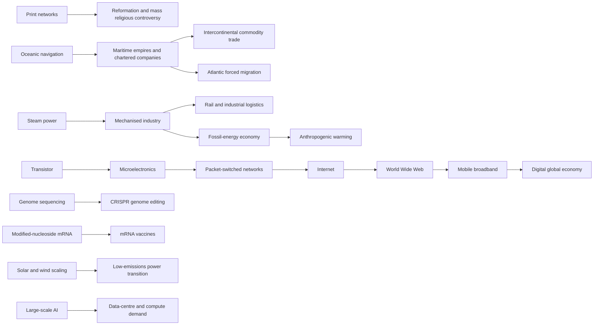

# World History Atlas: Global History from 1500 to 2026

## Executive summary

The period from **1500 CE to 21 October 2026** is best understood not as a simple transition from pre-modern societies to a Western-led modern world, but as the interaction of several overlapping transformations: the persistence and expansion of large agrarian empires; intensification of intercontinental maritime exchange; conquest and coerced migration; industrialisation and fossil-energy use; extraordinary demographic and urban growth; imperial expansion followed by decolonisation; mass politics and international institutions; and, eventually, electronics, digital networks, biotechnology, renewable energy and artificial intelligence. The balance among those systems varied substantially by region and century. citeturn5search11turn5search4turn6search11turn6search6turn13search3

The early modern world was emphatically **multipolar**. The Ottoman, Safavid, Mughal, Ming/Qing and Tokugawa political systems coexisted with major African, Southeast Asian, American and Indigenous societies. European maritime powers became increasingly important after 1500, but for much of the sixteenth and seventeenth centuries they operated alongside—and often within trading systems controlled by—large Asian and African states rather than simply replacing them. The Mughal dynasty began in northern India in 1526; Qing rule replaced Ming authority during the seventeenth century; the Tokugawa settlement from 1603 created a durable Japanese political order; and Ottoman power remained a major force across southeastern Europe, Anatolia, West Asia and North Africa. citeturn5search4turn5search11turn6search11turn6search6

At the same time, European colonisation profoundly transformed the Americas and eventually Australia, Africa and Asia. The fall of Tenochtitlan in 1521 and Spanish seizure of Atahualpa in 1532 were political collapses of imperial states, **not disappearances of Indigenous peoples or cultures**. Indigenous allies, existing political divisions, disease, colonial violence and subsequent institutions all mattered. In Australia, permanent British settlement began at Sydney Cove in 1788 on lands already occupied by diverse Aboriginal societies with much deeper histories. citeturn21search19turn21search11turn21search17turn6search9

The Atlantic economy was inseparable from coercion. SlaveVoyages estimates approximately **12.52 million captive Africans embarked in the trans-Atlantic slave trade between 1501 and 1866**. The eighteenth century was its largest century: the project's interval estimates imply about 6.49 million embarkations from 1701 through 1800. These figures are reconstructed estimates rather than exact counts, because surviving voyage documentation is incomplete; SlaveVoyages explicitly uses methods to estimate undocumented traffic. citeturn2search0turn2search1turn2search2


Industrialisation from the late eighteenth and nineteenth centuries fundamentally altered production, energy, transport, military capacity and urban life, but did not reduce humanity's pressure on land. HYDE reconstructions suggest global cropland rose from roughly **265 million hectares in 1700 to about 1.47 billion hectares by 1990**, while pasture increased on an even larger absolute scale. Such estimates are modelled historical reconstructions and should be displayed in an atlas as ranges or estimates, not exact surveyed totals. citeturn1search5turn1search10

Demographic change was equally dramatic. Long-run reconstructions place global population at roughly **595 million in 1700**, around **983 million in 1800** and approximately **1.6 billion by 1900**; the United Nations marked **15 November 2022** as the eight-billion milestone and estimated about **8.2 billion people in 2024**. The UN's 2025 urbanisation revision estimates that cities contain about 45% of humanity under its harmonised settlement definition, more than twice their 1950 share. citeturn18search0turn7search1turn1search0turn1search6


The twentieth century combined industrial capacity with unprecedentedly destructive warfare, genocide and pandemic disease. The 1918 influenza pandemic infected an estimated one-third of the world's population and caused at least 50 million deaths according to the CDC's historical assessment. Nazi Germany and its allies and collaborators murdered six million European Jews during the Holocaust, alongside the persecution and killing of millions of other victims. The Second World War killed at least tens of millions and produced enormous displacement and political transformation. citeturn11search0turn14search4turn14search8turn15search13

After 1945, decolonisation transformed the political map. At the founding of the United Nations, roughly **750 million people lived in dependent territories**; the UN reports that more than 80 former colonies subsequently gained independence. The **Universal Declaration of Human Rights**, adopted in Paris on 10 December 1948, added an increasingly influential universal-rights vocabulary to an international system still organised primarily around states. citeturn13search3turn13search11turn13search0turn13search2

The post-war technology sequence is especially important for an interactive atlas because it is a chain rather than a collection of isolated inventions: the transistor at Bell Laboratories in 1947 enabled modern solid-state electronics; ARPANET demonstrated computer networking from 1969; the Web was developed at CERN from 1989 and released without royalties into the public domain in 1993; the Human Genome Project ran from 1990 to 2003; CRISPR-Cas9 became a programmable genome-editing method in the early 2010s; and modified-nucleoside mRNA work first published in 2005 helped make the 2020 mRNA COVID-19 vaccines feasible. citeturn15search15turn12search6turn12search0turn12search2turn15search1turn16search12turn15search0

The present-day world is simultaneously more connected and more fragmented. In 2025, ITU estimated **6.0 billion people—74% of the global population—were online**, while 2.2 billion remained offline. WTO data put combined world trade in goods and commercial services at **US$34.89 trillion in 2025**. IEA data show renewables supplying around 34% of global electricity and record renewable-capacity additions of roughly 800 GW in 2025. Stanford's 2026 AI Index reports global corporate AI investment of about **US$581.7 billion in 2025**. Yet UNHCR recorded **117.8 million forcibly displaced people at the end of 2025**, and major wars in Ukraine and Sudan and the humanitarian crisis in Gaza remained active concerns at the **21 October 2026 research cut-off**. citeturn19search0turn8search0turn19search15turn19search16turn19search8turn17search0turn9search13turn9search0turn9search19

The accompanying atlas package operationalises the research in machine-readable form. It contains **60 event/development records, 35 society/polity catalogue records, 30 technology records, 20 relationship records, 33 georeferenced event/reference points, three deliberately schematic route geometries, six verified digitised historical-map records, 14 cross-civilisation historical connections, 37 statistical observations, 15 explicit research gaps and a register of 71 sources accessed during this research pass**. It follows the supplied project brief's requirements for stable IDs, uncertainty, provenance, time-bounded records and avoidance of invented territorial precision. fileciteturn0file0

[Download the complete World History Atlas 1500–2026 research package](sandbox:/mnt/data/world_history_atlas_1500_2026.zip)

## Historical transformation across five centuries

**The sixteenth and seventeenth centuries were a period of simultaneous imperial consolidation and expanding oceanic connection.** Ottoman victory at Chaldiran in 1514 helped define a durable Ottoman–Safavid frontier, while Süleyman I's reign from 1520 to 1566 combined territorial expansion with major legal, architectural and artistic patronage. In South Asia, Mughal rule began after Babur's victory at Panipat in 1526, while Vijayanagara and the Deccan sultanates remained major southern powers. In China, the seventeenth-century Ming crisis culminated in Qing conquest and consolidation; in Japan the Tokugawa order beginning in 1603 presided over agricultural, commercial, transport, urban and literacy growth. citeturn5search11turn5search10turn5search5turn6search11turn6search6

Religious and information systems changed at the same time. Martin Luther's 1517 challenge to indulgences would have been far less consequential without print networks able to reproduce and circulate controversy rapidly. The Reformation fragmented western Christendom, intersected with state-building and eventually contributed to confessional warfare. The Thirty Years' War ended in 1648 with the Westphalian settlements, which altered territorial and confessional arrangements in Europe; it is safer to describe Westphalia as an important reconfiguration of European interstate politics than as the instantaneous "birth" of modern sovereignty. citeturn20search14turn20search15turn20search6

The same period saw accelerating European conquest in the Americas. Tenochtitlan—possibly a city of around 200,000 people at the time of conquest and therefore one of the world's largest urban centres—fell in 1521. Pizarro reached the Inca sphere amid civil conflict and captured Atahualpa at Cajamarca in 1532, but Spanish consolidation of the former Inca realm was a prolonged process extending to 1572. These should be represented as multi-stage conquest processes involving Indigenous allies, adversaries and successor communities, not one-point "discoveries". citeturn21search15turn21search19turn21search11

Meanwhile, African political history was dynamic rather than merely reactive to Europe. Akan political consolidation contributed to the rise of Asante; Dahomey and Oyo developed as important West African states; Kongo, Ndongo and Luba polities followed different trajectories in Central Africa; and Mutapa and other southern African societies remained connected to Indian Ocean commercial systems. Atlantic slavery profoundly affected many of these societies, but it should not be used as the sole organising framework for African history. citeturn6search0turn6search16turn5search8

**The eighteenth and nineteenth centuries combined political revolution, coerced mobility and industrial transformation.** The American Revolution produced an independent United States after the 1776 declaration and the internationalised war ending in 1783. The French Revolution began in 1789 and eventually destroyed the Bourbon monarchy. The Haitian Revolution from 1791 to 1804 was more radical in another dimension: an uprising in a slave plantation colony abolished slavery and produced an independent state governed by people who had defeated a European colonial regime. citeturn13search13turn20search9turn13search12

These political revolutions unfolded during the peak era of Atlantic slavery. Estimated embarkations rose from about 1.21 million in 1651–1700 to approximately 2.56 million in 1701–1750 and 3.93 million in 1751–1800. The nineteenth-century decline in the Atlantic trade was uneven: SlaveVoyages still estimates around 3.65 million embarkations from 1801 through 1850. The eventual suppression of the trade therefore must not be confused with an immediate end to slavery itself. citeturn2search0turn2search2

European imperial systems simultaneously expanded in Asia, Africa and the Pacific. The English East India Company, chartered in 1600, evolved from a commercial participant in South Asian markets into a major military-territorial power by the later eighteenth century. The 1857 uprising helped end Company government, after which the British Crown assumed direct rule in India. Across Southeast Asia, Britain, France and the Netherlands extended colonial control during the nineteenth century, while Siam/Thailand avoided formal colonisation. France constituted its Indochinese federation in 1887. citeturn5search4turn5search12

Australia followed a distinct settler-colonial trajectory. Dutch mariners made recorded European landfalls in the seventeenth century, Cook claimed the east coast for Britain in 1770, and permanent British settlement began in 1788. Such dates mark European actions, not the "beginning" of Australian history: Aboriginal and Torres Strait Islander societies predated them by millennia and persisted through dispossession, demographic disruption and colonial government. citeturn6search9

Industrialisation increasingly altered the material basis of state power. Steam-powered machinery, mechanised factories, railways, telegraph systems, mass steelmaking, electrification and eventually internal-combustion transport reduced transport and communication costs while increasing the speed at which states and firms could move commodities, capital, soldiers and information. The package treats these technologies as systems of invention, adoption and diffusion rather than attributing complex transitions to single heroic inventors; several of the nineteenth-century technology rows remain provisional and require technology-specific source auditing before production use.

**From 1914 to 1945, industrial power was turned toward mass warfare.** The two world wars were global not merely because fighting occurred on multiple continents but because imperial forces, raw materials, shipping networks and colonial populations were deeply incorporated into them. The Holocaust further demonstrated how modern bureaucracy, transport infrastructure, police power, racial ideology and industrial warfare could be combined into systematic genocide. citeturn15search13turn14search4turn14search8

Pandemic disease interacted directly with these global networks. The 1918–19 influenza pandemic spread during an era of mass mobilisation and transport and caused mortality on a scale comparable with major wars. Later twentieth-century public health demonstrated the opposite possibility: after WHO intensified the smallpox eradication campaign in 1967, the last naturally acquired case occurred in Somalia in 1977 and global eradication was certified in 1980. That achievement linked an eighteenth-century vaccination principle to twentieth-century surveillance, logistics and international coordination. citeturn11search0turn11search4turn11search5

**After 1945, political fragmentation of empires coexisted with institutional globalisation.** Decolonisation created scores of sovereign states while the United Nations, international financial and trade institutions and later regional organisations built increasingly dense frameworks for interstate coordination. This was not an uncomplicated transition to equality: new states inherited colonial borders, economic dependencies and conflicts, while Cold War competition penetrated civil wars and revolutions across Asia, Africa, Latin America and the Middle East. The present dataset captures decolonisation at the global level but its Cold War event graph is not yet detailed enough for production. citeturn13search3turn13search11

**The late twentieth and early twenty-first centuries produced a second great connectivity transformation.** The transistor made small, reliable electronic switching practical; packet-switched networks connected computers; the Web created a common hypertext system; and mobile broadband eventually brought network access to billions. This sequence matters because an atlas technology tree should separate invention from scaling: the Web is not the Internet, the Internet did not begin with smartphones, and digital globalisation rests on decades of layered infrastructure. citeturn15search15turn12search6turn12search0turn19search11

Biotechnology followed its own cumulative sequence. The Human Genome Project generated a reference sequence and a shared data infrastructure; CRISPR converted a bacterial molecular system into a programmable editing method; modified-nucleoside mRNA research solved important immunological obstacles that had limited therapeutic mRNA and subsequently contributed to highly effective COVID-19 vaccines. These are excellent candidates for prerequisite/dependency edges in the Atlas technology graph. citeturn15search1turn15search5turn16search12turn16search13turn15search0turn15search4

COVID-19 revealed both the strength and fragility of contemporary global systems. WHO estimates **14.91 million excess deaths associated directly or indirectly with the pandemic during 2020–2021**, substantially above recorded confirmed COVID deaths for the same period. WHO also estimates that the pandemic reversed part of decades-long health gains, with global life expectancy falling during 2019–2021. citeturn0search0turn0search2turn0search7

Climate change is now inseparable from the modern-history layer. The IPCC concludes that human activities have **unequivocally caused global warming**, with 2011–2020 global surface temperature around 1.1°C above 1850–1900. WMO subsequently assessed 2025 at roughly 1.44°C above the 1850–1900 mean and among the three warmest years on record. FAO's 2025 global forest assessment still recorded approximately 4.14 billion hectares of forest, but continuing deforestation alongside long-run cropland expansion shows that industrial modernity is also a history of planetary land transformation. citeturn10search4turn10search0turn10search1

## Regional and thematic comparison

| Region | Major political trajectory | Economic and social transformation | Cultural, technological and atlas implications |
|---|---|---|---|
| **Europe** | Reformation and confessional states; interstate war; Atlantic empires; industrial nation-states; two world wars; post-war integration | Commercial expansion followed by early industrialisation and very rapid nineteenth-century urban transformation | Print is crucial from the Reformation onward; industrial and later digital technology chains should be mapped without treating European adoption as universal chronology. citeturn20search14turn20search6turn15search13 |
| **West and Central Asia** | Ottoman–Safavid competition; Ottoman imperial longevity; later imperial contraction, nationalism and post-imperial state formation | Mediterranean, Red Sea, Persian Gulf and overland trade remained important even as Atlantic commerce expanded | Ottoman legal, architectural and artistic history illustrates why a political polygon alone is inadequate as a civilisation profile. citeturn5search11turn5search10 |
| **South Asia** | Mughal consolidation and fragmentation; regional successor states; East India Company expansion; British Crown rule; twentieth-century decolonisation | Major textile and agrarian economy increasingly tied to European companies and later colonial infrastructure | Mughal, Deccan and Vijayanagara histories need simultaneous timelines rather than a colonial-only sequence. citeturn5search4turn5search5 |
| **East Asia** | Ming–Qing transition; Qing territorial expansion; Tokugawa political stability; nineteenth- and twentieth-century transformations | Dense agrarian economies and major commercial cities; tea, silk and porcelain connected Asia with international markets | Qing and Tokugawa trajectories undermine any model in which "modernisation" simply arrives from Europe at a single date. citeturn6search11turn6search6 |
| **West, Central and Southern Africa** | Asante, Oyo, Dahomey, Kongo, Ndongo, Luba, Mutapa, Zulu, Merina and numerous other changing polities; later colonial conquest and decolonisation | Regional commerce, Atlantic and Indian Ocean exchange, forced migration and later colonial commodity systems | African history requires many regional nodes and relationship types; the trans-Atlantic slave trade is central but cannot substitute for political and cultural history. citeturn6search0turn6search16turn5search6turn2search0 |
| **Americas** | Destruction or transformation of major Indigenous empires; colonial viceroyalties and settler colonies; independence revolutions; expanding republics | Silver and plantation economies; catastrophic Indigenous demographic disruption; mass African forced migration; later industrialisation and migration | Indigenous continuity must be modelled separately from the collapse of imperial states. U.S., Haitian, Spanish-American and Brazilian independence need separate event chains. citeturn21search19turn21search11turn6search3turn13search12 |
| **Southeast Asia** | Diverse kingdoms and sultanates followed by uneven British, French and Dutch colonial incorporation; Thailand remained formally independent | Export agriculture, port cities, plantation economies and increasingly global maritime trade | Production data need local-state records alongside colonial records; "colonial Southeast Asia" is not a single political entity. citeturn5search12 |
| **Australia and Pacific** | Persistent Indigenous societies; European maritime exploration; settler colonisation in Australia and later Pacific imperial partition | Maritime exchange followed by mission, settler and colonial economies; major Indigenous demographic and territorial disruption | Pacific navigation should be modelled as Indigenous knowledge in its own right, not merely as the background to Cook's voyages. European charting accelerated between 1768 and 1780 but did not constitute the discovery of already inhabited islands. citeturn6search9turn6search10 |
| **Global system after 1945** | Decolonisation, UN-centred diplomacy, Cold War and post-Cold-War conflicts | Mass consumer production, trade globalisation, international migration, finance, digital services and highly integrated supply networks | Technology increasingly diffuses globally but very unequally; political sovereignty, digital integration and material prosperity remain distinct variables. citeturn13search3turn19search0turn17search14 |

Several comparisons are particularly valuable for an atlas.

First, **state collapse is not cultural disappearance**. The Mexica imperial political system collapsed in 1521; Inca imperial authority was dismantled over subsequent decades; Mughal central authority fragmented long before the dynasty formally ended in 1858. In each case populations, languages, religions, institutions and cultural traditions survived political transformation. The data model therefore separates stable society identifiers from changing polity-period observations. citeturn21search19turn21search11turn5search4

Second, **trade integration can coexist with extreme coercion**. The growth of Atlantic commerce was contemporaneous with the forced transportation of millions of Africans. In the twenty-first century, global trade has reached record nominal values while displacement remains historically enormous. Economic "globalisation" consequently needs separate variables for trade volume, mobility rights, forced migration and political violence. citeturn2search0turn8search0turn17search0

Third, **urbanisation should not be confused with simple population growth**. Population has increased roughly fivefold since 1900, while settlement patterns have simultaneously shifted toward towns and cities. Under the UN's 2025 harmonised definition, about 45% of humanity now resides in cities, with further shares living in towns and semi-dense settlements. The historical atlas therefore benefits from separate population, urban share and settlement-size layers. citeturn18search0turn1search0turn1search6

Fourth, **migration has changed form rather than simply increased continuously**. Early-modern forced Atlantic migration, nineteenth-century settler and labour migration, twentieth-century refugee crises, post-war labour migration and contemporary internal displacement need distinct classifications. IOM's World Migration Report places the international migrant stock at roughly 281 million people, or about 3.6% of global population, while UNHCR's refugee and internal-displacement categories measure a different phenomenon and should not be merged with that total. citeturn17search14turn17search0


The end-2025 UNHCR total of 117.8 million forcibly displaced people was below the 2024 year-end figure of 123.25 million but still extraordinarily high. Some 68.7 million were conflict- or violence-displaced internally, illustrating why a map limited to cross-border refugees would omit most forced displacement. citeturn17search0turn17search2

The digital world is likewise uneven. ITU's 2025 figures indicate Internet use of about 94% in high-income economies but only about 23% in low-income economies; globally, urban Internet use was approximately 85% compared with 58% in rural areas, and the gender gap remained material. 5G coverage had reached around 55% of humanity but only about 4% of people in low-income economies. An atlas layer labelled simply "Internet adopted" would therefore hide most of the historically significant geography. citeturn19search0turn19search12turn19search13turn19search2

Environmental history should also be integrated rather than confined to a climate appendix. Agricultural expansion, forest clearance, fossil-energy consumption, urban growth and technological change are historically coupled. FAO reports that agricultural land covered about 4.6 billion hectares in 2024 and that cropland expansion remains an important driver of forest loss; IPCC evidence links cumulative greenhouse-gas emissions to contemporary warming. citeturn10search12turn10search4

## Timelines, maps and worldviews

The high-level chronology can be rendered directly in Mermaid. The corresponding event records, with source IDs, confidence fields and date precision, are included in the downloadable dataset.

```mermaid
timeline
    title Selected global transformations, 1500–2026
    1514 : Ottoman–Safavid confrontation at Chaldiran
    1517 : Protestant Reformation begins
    1521 : Tenochtitlan falls
    1526 : Mughal rule founded in northern India
    1532 : Atahualpa captured at Cajamarca
    1570 : Ortelius publishes Theatrum orbis terrarum
    1600 : English East India Company chartered
    1603 : Tokugawa shogunate established
    1644 : Qing conquest of Beijing
    1648 : Peace of Westphalia
    1700s : Peak century of trans-Atlantic slave embarkations
    1776–1783 : American Revolution
    1788 : British settlement at Sydney Cove
    1789 : French Revolution begins
    1791–1804 : Haitian Revolution
    1796 : Jennerian vaccination
    1800s : Industrialisation accelerates
    1857–1858 : Indian uprising and transfer to Crown rule
    1865 : US Thirteenth Amendment
    1914–1918 : First World War
    1918–1919 : Influenza pandemic
    1939–1945 : Second World War and Holocaust
    1945 : United Nations and accelerated decolonisation era
    1948 : Universal Declaration of Human Rights
    1969 : First ARPANET host-to-host signal
    1980 : Smallpox eradication certified
    1989–1993 : World Wide Web created and openly released
    1990–2003 : Human Genome Project
    2005 : Modified-nucleoside mRNA breakthrough
    2012 : Programmable CRISPR-Cas9 editing
    2020 : COVID-19 pandemic and mRNA vaccine deployment
    2022 : World population reaches eight billion
    2025 : Six billion Internet users and record renewable additions
    2026 : Atlas research cut-off
```



The key early-modern milestones in this timeline are supported by Library of Congress, Metropolitan Museum and institutional historical collections; the modern science and health sequence is supported by WHO, DARPA, CERN, NHGRI and Nobel documentation. citeturn5search11turn20search14turn21search19turn21search11turn12search6turn12search0turn15search1turn15search0

A dependency-oriented technology view is more useful than a chronological "list of inventions":



For technology-tree purposes, arrows should mean a documented prerequisite or enabling relationship, **not mere chronological precedence**. For example, CERN's Web required an existing Internet but did not create the Internet itself; CRISPR-Cas9 builds on molecular genetics and prior CRISPR research; and today's mRNA vaccines depend on a long chain involving mRNA synthesis, immunology, modified nucleosides and delivery technology. citeturn12search6turn12search0turn16search12turn15search0

The "see the world through their eyes" feature needs an even stricter evidential model. Historical maps are evidence for **geographical knowledge, misconception and representational convention**, not direct GIS ground truth. The package therefore distinguishes attested historical maps from inferred awareness and unsupported areas, following the three-layer concept in the project brief. fileciteturn0file0

A particularly useful starting set is Abraham Ortelius's **Theatrum orbis terrarum** of 1570. The Library of Congress describes the work as the first modern atlas in the sense of a coherent collection of uniformly prepared maps; successive editions incorporated changing geographical knowledge. Ortelius's Africa and Asia maps also expose the limitations of contemporary European information. The Asia map, for example, preserves distortions in the representation of Japan and gaps or conjectures elsewhere. citeturn16search6turn16search7turn16search2turn16search11

Joan Blaeu's 1659 world map provides a later European knowledge snapshot associated with the Dutch cartographic and commercial world. Its incomplete western North American, Arctic and Australian geography is historically valuable precisely because it is incomplete. Jean Cossin's 1570 sinusoidal world map provides another independent European cartographic tradition. citeturn16search0turn16search1turn16search5

The current historical-map catalogue contains six verified digitised items, but it is **European-heavy**. That is a research deficiency, not an assertion that Europeans possessed uniquely important geographical knowledge. Production work should add Ottoman, Persian, Chinese, Korean, Japanese, South Asian, Arabic/Islamic, Indigenous American, Aboriginal and Pacific traditions from the relevant libraries, archives and scholarship before the worldview feature is treated as globally representative.


The plotted points above deliberately show only locations for which a defensible event/reference coordinate could be assigned. A battle point, capital point or treaty city is **not the geometry of the underlying war or state**, and the GeoJSON explicitly carries that warning.

## Atlas data package and geospatial architecture

The package is designed as an importable research foundation rather than as a prose-only history.

| Deliverable | Contents | Production status |
|---|---:|---|
| `historical_events.csv` + JSONL | 60 events/developments with dates, region, actors, summaries, confidence and source IDs | Strong foundation; medium/low rows need further claim-level audit |
| `societies.csv` + JSONL | 35 representative societies/polities | Broad starter catalogue, **not** a complete global civilisation list |
| `technology_developments.csv` + JSONL | 30 technology-system records | Strongest after 1947; nineteenth-century invention/origin records remain provisional |
| `relationships.csv` + JSONL | 20 inter-society relationships | Demonstrates graph schema; far from complete |
| `events_points.geojson` | 33 GIS-ready event/reference points | Production-usable when coordinate precision is displayed |
| `schematic_routes.geojson` | 3 illustrative historical corridors | **LOW confidence; visualisation/prototyping only** |
| `historical_maps.csv` + JSONL | 6 digitised map records with holding institution and rights notes | Verified starter set; geographically biased toward European cartography |
| `statistical_series.csv` + JSONL | 37 historical/contemporary measurements | Suitable for chart prototypes; historical estimates require uncertainty treatment |
| `historical_connections.csv` + JSONL | 14 "meanwhile elsewhere" records | Suitable for educational exploration prototypes |
| `regional_snapshots.csv` + JSONL | Comparative political/economic/social/cultural summaries | Analytical layer, not raw primary data |
| `sources.csv` + `sources.json` | 71 accessed-source records | Provenance register; final publication should recheck rights and persistent identifiers |
| `research_gaps.csv` + JSONL | 15 explicit deficiencies and priority actions | Intended to drive subsequent research batches |
| `atlas_event_schema.json` | JSON Schema for event validation | Ready as a starting schema |
| `mermaid_diagrams.md` | Timeline and systems-flow diagrams | Ready |
| `quality_report.json` | Counts, confidence distribution and limitations | Ready |
| `figures/` | Four PNG visualisations | Ready for prototyping |

[Download the complete package](sandbox:/mnt/data/world_history_atlas_1500_2026.zip)

The source architecture should remain relational. A civilisation or society should have one persistent identity, while names, capitals, territorial extent, governments and foreign relationships become time-dependent observations. That avoids errors such as treating "Ottoman Empire in 1520" and "Ottoman Empire in 1800" as unrelated entities, or assuming that an imperial capital and boundary were constant over centuries. This directly implements the data-modelling principle in the research brief. fileciteturn0file0

For geospatial production, the most reliable architecture is:

**Modern reference geography:** Natural Earth provides public-domain small-scale physical and political base layers at multiple scales; GeoNames provides a WGS84 gazetteer with millions of named features under CC BY 4.0. Neither should be mistaken for a historical-border database. citeturn3search12turn4search1turn4search2

**Historical entity reconciliation:** World Historical Gazetteer is valuable for historical place identifiers, variant names and linked-place reconciliation. PeriodO provides persistent identifiers and machine-readable definitions for named historical periods. citeturn3search0turn3search1turn4search12

**Linked entity metadata:** Wikidata can provide identifiers and entity links under CC0, but disputed historical claims should be independently sourced rather than inherited from Wikidata. citeturn4search0turn4search3

**Open historical geometry:** OpenHistoricalMap is potentially valuable for time-tagged historical features, but its own documentation makes feature-level provenance and licence inspection important where external datasets have been imported. It should therefore be an ingestion candidate, not an unquestioned authority. citeturn3search10turn3search6

A production `historical_geometries` layer should minimally contain:

```json
{
  "geometry_id": "stable-id",
  "entity_id": "civilisation-or-place-id",
  "geometry_type": "core | controlled | claimed | disputed | influence | route",
  "valid_from": "date-or-bound",
  "valid_to": "date-or-bound",
  "geometry": "GeoJSON geometry",
  "spatial_precision": "high | medium | low",
  "evidence_type": "survey | historical-map | textual-reconstruction | scholarly-reconstruction",
  "confidence": "HIGH | MEDIUM | LOW | DISPUTED | UNKNOWN",
  "source_ids": ["source-id"]
}
```

This distinction is crucial. Many pre-modern and early-modern polities did not possess modern surveyed borders. A single hard polygon implies a degree of sovereignty and spatial precision that may never have existed. The current package therefore intentionally contains **no fabricated empire-boundary shapefiles**. That is a limitation, but it is preferable to false precision and directly follows the supplied research specification. fileciteturn0file0

The demographic and economic series should likewise preserve provenance. Maddison Project Database 2023 offers long-run GDP-per-capita and population estimates for 169 countries extending back, where evidence permits, to the first millennium; these are reconstructed historical estimates, not contemporary national accounts. UN WPP is preferable for modern demographic estimates and projections, while World Urbanization Prospects provides the most coherent contemporary global settlement series. citeturn18search1turn7search7turn1search6

For economic-globalisation layers, WTO, UNCTAD and UN maritime statistics provide distinct measures: nominal trade values, service/goods decomposition and shipping dependence. UNCTAD notes that more than 80% of international merchandise trade by volume is carried by sea, an important reason maritime chokepoints should eventually become a first-class atlas feature. citeturn8search0turn8search3turn8search13

At the 2026 cut-off, the contemporary layer should be explicitly versioned rather than overwritten. IMF's October 2026 World Economic Outlook projected global growth of about 3.1% for 2026 and 3.4% for 2027, but such forecasts will be revised. The same applies to war, migration, public-health and climate records. Every modern observation should therefore contain `observed_at` or `research_cutoff` metadata. citeturn8search8

## Evidence quality, limitations and production priorities

The strongest parts of this research pass are the **source-backed global statistical series; selected early-modern regional political history; trans-Atlantic slave-trade estimates; twentieth- and twenty-first-century public health; post-war digital and biotechnology milestones; climate and energy indicators; and the initial historical-map register**. These rely heavily on official or institutional sources including the UN system, WHO, ITU, WTO, IMF, IPCC, FAO, UNHCR, IEA, U.S. National Archives, Library of Congress, Smithsonian, Australian War Memorial, USHMM, CERN, DARPA and NHGRI, supplemented by scholarly datasets such as SlaveVoyages, Maddison and HYDE. citeturn7search1turn2search0turn10search4turn11search4turn12search0turn15search1

The dataset should nevertheless **not be described as an exhaustive World History Atlas database**. Sixty event records across 526 years are sufficient for a global scaffold but nowhere near adequate for decade-level production coverage. The same is true of 35 polity/society records. The value of the current package is that it establishes a source-aware schema and a set of well-researched anchor records without pretending that missing entities did not exist.

The most serious gap is historical political geometry. No credible one-source global set can turn Ottoman, Mughal, Qing, Asante, Indigenous, colonial and modern territorial concepts into uniformly precise polygons. Historical sovereignty ranged from directly administered cores through tributary systems, frontier zones, seasonal control, overlapping claims and culturally defined territories. Boundary acquisition should therefore proceed region by region, with separate geometry semantics instead of an "empire colour fill" model.

Indigenous geography is the second major weakness. The umbrella catalogue record for Aboriginal and Torres Strait Islander societies is intentionally inadequate for a final atlas. Nation-, language- and Country-level data should come wherever possible from Indigenous-led or Indigenous-endorsed gazetteers and mapping projects rather than reverse-engineering Indigenous territories from colonial maps. Comparable care is needed in North America, Amazonia, the Arctic and Pacific.

Historical worldviews are another major gap. The six-map verified set gives a useful demonstration of the evidence model but is disproportionately European. A credible "see the world through their eyes" function requires an entirely separate research programme covering Chinese world maps and gazetteers, Korean and Japanese cartography, Ottoman and wider Islamic geographical writing, South Asian mapping traditions, Indigenous route and landscape knowledge, Polynesian navigation and other forms of geographical knowledge that do not necessarily resemble European paper maps.

Everyday life is underdeveloped relative to political and technological history. Food, housing, childhood, family organisation, clothing, gendered work, sanitation, recreation, craft production and ordinary religious practice should be built from museum collections, archaeological work and social history. Evidence bias should be explicit: the lives of rulers, literate elites and urban institutions are usually much better documented than those of rural workers, enslaved people, women and children.

The **historical-figures dataset is not yet production-ready** and was deliberately not included as a standalone release rather than padding the project with weakly sourced biographical rows. A proper figure table should cover not just rulers and European inventors but religious leaders, generals, administrators, writers, artists, scientists, anticolonial organisers, Indigenous leaders, women and actors whose names survive outside elite state archives.

Several nineteenth-century technology records in the generated technology table are deliberately **MEDIUM or LOW confidence synthesis records** rather than invention-grade research. Steam, telegraphy, railways, industrial steel, electrification, aviation, germ theory, antibiotics and nuclear technology warrant separate technology-history passes in which "earliest evidence", "invention", "improvement", "regional adoption" and "widespread use" are distinct records. The fact that an artefact or document is the earliest surviving evidence must never automatically be converted into a claim of invention, exactly as specified in the project brief. fileciteturn0file0

The Cold War is too thinly represented. A production-quality 1945–1991 layer needs the Chinese Revolution and Korean War, partition and conflicts in South Asia, Vietnam and Indochina, Arab–Israeli wars, Cuban Revolution and missile crisis, African liberation wars, coups and civil wars, Soviet interventions, Latin American dictatorships and democratisation, détente, nuclear arms-control regimes and the eventual dissolution of the Soviet system. Those should be researched regionally rather than generated from a single "Cold War" master narrative.

The nineteenth-century independence of Spanish America and Brazil is likewise missing from the current event-level dataset. That is too large a historical omission for a final atlas. The existing U.S. and Haitian Revolution records establish a schema, but the next Americas batch should cover independence from Mexico through the Andes and Southern Cone, Brazilian independence, Indigenous and enslaved participation, changing borders and the persistence of colonial economic and racial structures.

West Asia and North Africa after 1800 also require substantially more coverage: Ottoman reform and nationalism, European imperial intervention, the First World War and Ottoman collapse, mandates, state formation, Arab nationalism, the Arab–Israeli conflict, Iranian constitutional and 1979 revolutions, Gulf monarchies and oil economies, and twenty-first-century wars and uprisings.

Current-conflict records are especially perishable. UN reporting in February 2026 described Russia's full-scale invasion of Ukraine as entering its fifth year, with more than ten million people needing assistance and more than ten million displaced; October reporting documented continuing elevated civilian casualties. In Sudan, UN reporting around the third anniversary of the April 2023 war put humanitarian need at nearly 34 million people. Such records must be timestamped and refreshed rather than silently treated as timeless facts. citeturn9search13turn9search4turn9search18turn9search0turn9search2

The overall confidence strategy should remain conservative:

| Confidence | Atlas interpretation |
|---|---|
| **HIGH** | Strong agreement among authoritative evidence or scholarship; suitable for normal presentation with provenance |
| **MEDIUM** | Credible but affected by meaningful dating, spatial or interpretive uncertainty; display caveat where relevant |
| **LOW** | Useful research lead, not yet sufficient for an unqualified public claim |
| **DISPUTED** | Competing scholarly interpretations should appear side by side |
| **UNKNOWN** | Evidence is insufficient; absence of evidence must not become evidence of absence |

This is particularly important for historical demography, where estimates centuries before modern census systems can differ greatly by methodology; for territorial extent, where border-like polygons are often modern reconstructions; for technology origins, where archaeological survival is uneven; and for societies with primarily oral historical traditions, where colonial archives can distort the evidentiary record.

The resulting production sequence should prioritise **depth by regional batches rather than artificial global uniformity**: historical boundaries and Indigenous geography; 1800–1914 political transformation; Cold War event networks; non-European historical maps and geographical knowledge; everyday-life datasets; historical figures; and technology-origin audits. The existing package provides stable IDs, event schemas, source tables, comparative regional summaries, GIS-ready reference points, statistical series, visualisations and explicit gap records on which those batches can be built without discarding the present work. fileciteturn0file0

**Research package totals at this release:** 35 society/polity records; 60 historical events/developments; 30 technology-development records; 33 georeferenced event/reference points; three schematic route geometries; 20 relationship records; six verified historical-map records; 14 cross-civilisation connection records; 37 statistical rows; 71 accessed sources; and 15 documented research gaps. The historical interval is **inclusive from 1500 CE through 21 October 2026**; continuing processes ending in `2026` mean "observed through the research cut-off", not that the event or institution ended in 2026.

[Download the complete World History Atlas dataset, GeoJSON, source register, Mermaid diagrams, visualisations and quality report](sandbox:/mnt/data/world_history_atlas_1500_2026.zip)