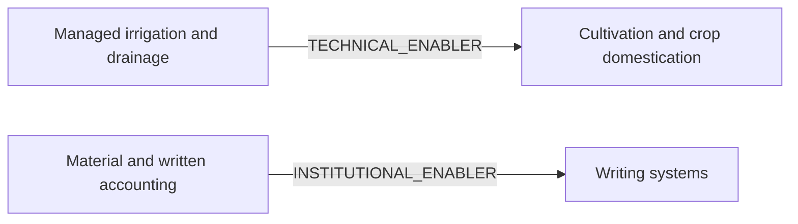

# Researched dependency diagram

Each edge corresponds to the listed evidence record; these are contextual enablers, not universal prerequisites.

Edge register: `dep_kuk_water_farming`, `dep_uruk_accounting_writing`
