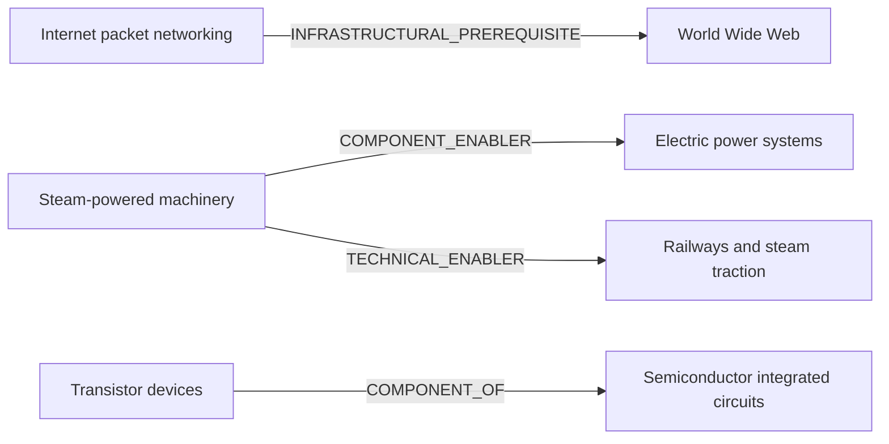

# Researched dependency diagram

Each edge corresponds to the listed evidence record; these are contextual enablers, not universal prerequisites.

Edge register: `dep_internet_web`, `dep_steam_electric`, `dep_steam_rail`, `dep_transistor_ic`
